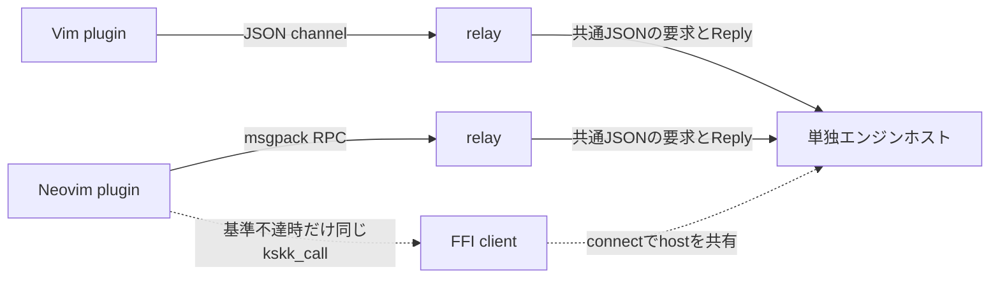

# ADR-0007: VimとNeovimはrelay経由の共通protocolを先に測り、FFIを逃げ道にする

- Status: Proposed
- Date: 2026-11-06
- Updated: 2026-11-12
- Deciders: kiyama
- Level: L3
- Phase: 6
- Supersedes: なし

## Context

ユーザーはskkeletonを置き換え、エディタでも他の機械と同じエンジンを使いたい。Denoの保守期限が計画上の制約である。出典は `docs/research/README.md` とPLANのGoal。VimとNeovimの両方を対象にするのはPLANの問い5にあるmanagerの判断で、所有者の新しい決定としては扱わない。

旧案はNeovimをLuaJIT FFI、Vimをjobに分けていた。しかしADR-0009の通常配置は、同じ機械・利用者のログを単独で書くエンジンホストである。エディタごとにエンジンとDictを組み込むことを既定にすると、この所有者が分かれる。

`local/agents/planner/20261112-diff-for-manager.md` のD6とmanagerの指示に従い、同じrelay経路を先に測る。Vimの公式channel文書は [同期JSON要求とjob](https://vimhelp.org/channel.txt.html#channel-use) を説明しているが、十分速いことは証明していない。今回、遅延は計測していない。

## Decision

- VimもNeovimも、jobとして仮称 `kskk connect` を起動する。relayは既存daemonへの接続、必要時の起動調整、hello、枠形式の変換を受け持つ。relay自体はDictやログの書き手にならない。
- Vim側のJSON channelと、Neovim側のmsgpack-RPCの違いはrelayで吸収する。運ぶ要求とReplyの意味はADR-0009の共通protocolとする。
- pluginは共通のVim scriptを基本とし、channelと候補窓などのエディタ依存部分だけを分ける。変換規則と学習をpluginへ移さない。
- frontendはキー、Textと意味コマンド、open/close/reset/flushを送る。返事のcommitを適用し、全体Viewを描く。前回のpreeditは表示を直すために保持してよい。
- このrelay経路を先に計測する。旧ADRのp99が10 ms以下という採否基準は維持する。これは推定: 製品上の判定基準であり、今回の計測値ではない。
- Neovimのrelay経路が基準を満たさない場合、同じbyte列のkskk_callをLuaJIT FFIで呼ぶ経路を比較する。まずconnect実装で単独hostを保てるか調べる。embeddedへ切り替える場合はADR-0009のV3に対する逃げ道として、file lockとtail追従も必要になる。FFIというだけで保存の排他を免除しない。

## 決め方

速度と正しさは実験で決める。relayの利便性を理由に旧基準を緩めず、FFIの速さも推測だけで合格にしない。

Vim系の最初のカードで、次の順に検査する。

1. 返事を固定できる偽のhostとrelayを用意し、VimとNeovimのjob経路を先に測る。次に実エンジン、ローカル辞書、学習の保存も含めて同じ経路を測る。偽のhostの測定だけで出荷経路を合格にしない。
2. conformanceの全対象キー列を流す。旧案の間隔100 msと20 msを保つ。両方とも推定: 通常入力と連打を比較する測定入力条件であり、所有者の打鍵速度を計測した値ではない。
3. キー受信から画面更新を確認できるまでの中央値とp99を出す。要求の待ち行列、relay、IPC、core、Learnのローカル保存、返事と描画を範囲に含める。通信RTTだけを画面遅延の代わりにしない。
4. 実画面の更新まで計れない試験では、描画API適用までなど終点を明記し、画面遅延を検証済みとしない。起動時とwarmな定常時、学習を伴うキーと伴わないキー、別sessionの負荷を分けて報告する。
5. 同じ機械、OS、build条件、ソースrevision、設定、辞書、キー列、間隔で比較し、試行数と生ログを残す。遅いキーや失敗試行を除いて集計しない。
6. relayが基準を満たさない場合だけNeovim FFIを同じ条件で測り、変更の効果を比較する。Vim側の不達も未解決のまま合格扱いせず、relayとhostの境界を見直す。

合格条件:

- キー受信から画面更新までのp99が10 ms以下。推定: 旧ADRから維持する採否基準。
- 20 ms間隔の条件でも、キーの欠落、順序逆転、確定文字列の重複適用がない。推定: 試験条件。
- エディタ経由のconformance観測が、同じエンジンをembedded hostで直接駆動した観測と一致する。
- 切断と期限切れを検査し、遅れたReplyを新しいsessionへ適用しない。再接続やflush/resetが学習の単独書き手を破らない。

## Options Considered

| 案 | 費用と変更 | 選択 |
|---|---|---|
| VimとNeovimをrelayへ揃える | 推定: 共通pluginとhostを保てる。relayの起動、枠変換、IPCの費用がある | 先に測る通常案 |
| NeovimだけFFIでkskk_callを呼ぶ | 推定: relayを省けるが、エディタ固有のbindingとライブラリ配布が増える。embeddedならログ排他も増える | 基準不達時の比較対象 |
| plugin側で変換規則を書き直す | 推定: 別エンジンが増え、同じ挙動と学習を保つ検査が増える | 採らない |
| Deno以外のruntimeへskkeletonを移す | 推定: 一時移行の案にはなるが、共通エンジンへの統合を終えたことにはならない | 通常案にはしない |

## Trade-off Analysis

relayを先に選ぶ理由は、保存の所有者を分けずにエディタ差を小さなglueへ閉じ込めるためである。プロセス境界が増える不利は実測で判断する。FFIは捨てずに比較対象として残すが、速さのためにログの安全性を落とさない。

## Consequences

- Neovimだけに型付きC構造体のbindingを配る既定案は取り下げる。C ABIを使う場合もADR-0009のbyte列の契約を使う。
- PLANとoverviewに残るNeovim FFI既定の表はmanagerの次の更新対象である。本変更ではそのファイルを編集しない。
- V3はまだ未計測。代替経路の性能も検証済みではない。

## Action Items

1. [ ] relayと偽のhostの計測カードを作り、終点、負荷条件、生ログを固定する
2. [ ] VimとNeovimのrelayを測り、実エンジンと保存を含めて旧基準を判定する
3. [ ] 不達の場合だけNeovim FFIと必要なembedded排他を比較する
4. [ ] エディタ経由のconformanceと、切断・再接続の試験を用意する
