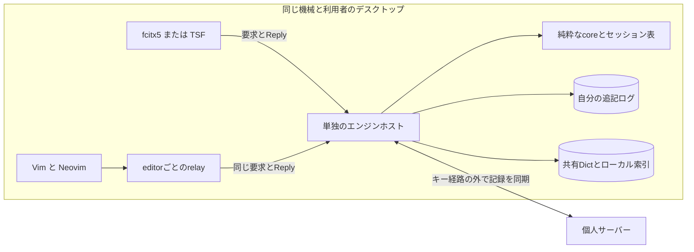

# ADR-0009: 純粋なコアをエンジンホストに集め、フロントエンドとは要求と全体Viewで分ける

- Status: Proposed
- Date: 2026-11-06
- Updated: 2026-11-12
- Deciders: kiyama
- Level: L2
- Phase: 2〜9
- Supersedes: なし

## Context

目的は、Windows、Linux、Vim/Neovim、将来のAndroidで、同じエンジンと学習データを使うことである。ユーザーの構造への要望は、`local/agents/owner-answers-2026-11-06.md:5` にある。

> 1: OK, but consider implementing engine. 2: Ok, but consider appropriate structure desion. I think clean or layered architecture is needed to separate to change parts of programs. and consider event-driven

今回の見直しは、プランナーの `local/agents/planner/20261112-diff-for-manager.md` のD1〜D5、D8と、managerの採用指示を記録する。原案の `20261112-zero-base-design.md` は14節で旧案を修正している。コアに時刻を渡す案、独自のLearn型、conformanceにconsumedを足す案は採らない。ADRのAccepted化ではなく、実装前の設計方針の更新である。

### 前提と出典

以下の前提を区別する。

| 前提 | 根拠と確度 |
|---|---|
| 同じ利用者の複数アプリが同じ機械のログを独立に追記してはいけない | `jisyo/SPEC.md` Recordは連続するseqを要求し、Mergeは同じ `(machine, seq)` の異なる内容をlog-conflictにする。契約からの帰結であり、競合実験を済ませたという意味ではない |
| エディタや入力メソッドをまたいで学習を共有する必要がある | PLANのGoal、ADR-0006。frontendごとのDictでは、他のfrontendが学習を読む仕組みが別に必要になる |
| Vimにはプロセス間通信の経路がある | 公式: [Vim channelのJSON要求とjob](https://vimhelp.org/channel.txt.html#channel-use)。同期のch_evalexprがあることは、遅延が小さいという証拠ではない |
| ローカルIPCにもアクセス制御が要る | 公式: [Linux unix(7)](https://man7.org/linux/man-pages/man7/unix.7.html) はpathname socketとプロセス資格情報の受渡しを説明する。[Microsoftのnamed pipe権限](https://learn.microsoft.com/en-us/windows/win32/ipc/named-pipe-security-and-access-rights) はDACLによる接続判定を説明する |
| WindowsのAppContainer内のTIPから、選んだ保存先と限定したpipeへ到達できるか | 未検証のV1。プランナーの見込みを確認済みの事実にしない。上の公式資料だけではこの組合せは確定しない |
| relay往復とfcitx5の同期IPCが十分速いか | 未計測のV3、V6。速度を理由にdaemonを確定したのではなく、失敗時の変更条件を置く |

## Decision

### 1. 層とエンジンホストの配置

| 層 | 責任 | 置き場所と依存 |
|---|---|---|
| 純粋な中心 | 状態遷移、キーから意味コマンドへの解決、辞書照会の組合せ、出力イベント | `core`。ファイル、ネットワーク、時計、スレッド、OSのキー表現を知らない |
| 純粋な辞書処理 | LearnEvent、LogRecord、merge、apply、diff、形式と文字コードの変換 | `jisyo`。既存の学習の型と意味を保つ |
| エンジンホスト | セッション表、Engine、DictとLookupの配線、ログの単独書き手、設定、同期クライアント、Replyへの畳み込み | `core`の外側。`jisyo`の保存処理を使う |
| フロントエンドとrelay | ホストのキー・ライフサイクルの翻訳、IPC、Replyの描画、未消費キーの扱い | 各frontend。relayはeditorの枠と共通JSONの変換だけを行う |

frontendはSKKの変換規則、辞書、学習ログ、共通設定を持たない。最後に描いたViewと、フォントや色などホスト固有の表示設定は持ってよい。

実装の境目はfrontend、embedded/接続の輸送路、ローカルのLookup、文字コードとIME形式、Clockに置く。実装が増えない場所にtraitを先回りして作らない。

#### D1の選択肢と費用

Nは同じ機械・利用者で同時に動くfrontendプロセス数を表す比較用の変数であり、所有者の実利用数を測った値ではない。下表の個数はすべて「推定: 設計モデル」である。IPC遅延、メモリ量、fsync時間の計測値はまだない。公式の性能値を代わりに置かない。

| 観点 | (a) 各プロセスがfile lockとlog tailを扱う | (b) 利用者ごとのエンジンホスト |
|---|---|---|
| ログの書き手 | 推定: N個。追記ごとに排他し、tailを読み直してからseqとtimeを決める | 推定: 通常は1個。host内で追記を直列化する |
| 利用者辞書の写し | 推定: N個。各プロセスが他の追記を取り込む | 推定: hostに1個の共有スナップショット。Stateはセッションごと |
| 追加プロセス | 推定: 組み込みfrontendでは追加なし。ただし同期の実行主体を別途決める必要がある | 推定: デスクトップは利用者ごとにdaemonを1個追加。editorはさらにeditorごとのrelayを持つ。AndroidはIME内に組み込む |
| 入力経路の費用 | 推定: 組み込み呼出しに加え、tail確認と学習時のlock待ち。時間は未計測 | 推定: 同期IPCと直列化の待ち。時間は未計測。ネットワーク同期待ちは含めない |
| 増える実装 | ロック範囲、部分末尾、tail追従、各Dictの更新、同期主体の寿命 | daemon起動と重複起動の排他、切断、セッション寿命、IPCの認証と上限 |
| 障害の広がり | 各アプリに分かれるが、古いDictと書き手間の競合を扱う必要がある | host停止で入力セッション全体へ影響する。確定済み学習はログから復元し、未確定状態は失い得る |
| 取り替えやすさ | frontendごとに組み込みの更新とプロセス再起動が必要 | hostを取り替えられるが、IPCの互換性とセッションの再作成が必要 |

(b)を通常配置とする。書き手、Dictの更新、同期の実行主体をまとめることが理由であり、「IPCは必ず速い」という推定では選ばない。学習の同時追記だけなら(a)でも解けるが、Dictの追従と同期主体の寿命は別に残る。

LinuxとWindowsは、同じ機械・利用者につきエンジンホストを単独にする。仮称はkskkd。Linuxは利用者専用runtime directoryのUnix socket、Windowsは利用者を識別するnamed pipeを使う。同一利用者の別ログオンセッションで別のログ書き手を作らない。endpointを分ける必要があっても、ログ所有者は共有する。Windowsの具体的なSID/DACLとAppContainerの権限はV1で検証する。

AndroidはIMEプロセス内に同じhostを組み込む。これは常駐daemonが別にあるという意味ではない。アプリが停止している間の常時同期も保証しない。

単独配置という宣言だけでは競合を防げない。起動時にログ所有権を排他的に獲得し、重複起動は既存hostへの接続か起動エラーにする。管理CLIや旧IMEからの取り込みも、この所有者を経由する。host稼働中に別のCLIが自分のログを直接追記してはならない。

V1の前提が成立しない、V3またはV6の実測が基準を満たさない場合は、そのplatformでembedded hostへ切り替える逃げ道を残す。プロトコルとglueの意味は保つ。その場合は(a)のfile lockとtail追従を実装し、lock取得、最新tailの検証、seq/timeの割当て、追記を同じ排他範囲に置く。他プロセスの学習はstepの間に取り込み、古いDictのまま使い続けない。daemonとembeddedが同じログへ無調整で書く混在は認めない。

### 2. エンジンの中心の形

`step(状態, 入力イベント, Lookup) -> (次の状態, 出力イベントの列)` を保つ。状態は複製して等値比較できる値である。コアは時刻を受け取らず、記録の時刻はhost側のClockで付ける。

`wants(state, key) -> bool` を副作用のない問い合わせとして加える。設定はEngineに固定し、wantsはLookupを呼ばない。falseなら、そのKeyをstepしても状態は不変で、出力はNotHandledだけになる。trueでも、確定してからEnterを渡す場合などにはstepがNotHandledを出してよい。

TSFのテスト段階と実際のkey-downの関係はV2で実機検証する。テストでTRUEと答えた後の素通しが成立しないなら、TIPがキーを消費してから送り直す。コアのwants不変条件をplatform依存の都合で変えない。

Lookupはstep中に固定された読み取り専用の値である。呼出し中にファイルを開いたり、ネットワークへ出たりしてはならない。利用者辞書はメモリ上のmerge結果、システム辞書は取り込み時に作ったmmap索引を使う。mmapのページフォルトまで無くなるという保証ではなく、遅延は実測する。skkservはこのLookup一覧から外す。将来使うなら、変換開始時だけの期限付き取得を別ADRで定める。

### 3. 入力、出力とfrontendプロトコル

Keyは文字に解決したキーとctrl/altで表す。CharのShiftは大小文字に畳む。Space、Enter、Backspace、Tab、Escape、Delete、矢印、Home、Endは名前付きキーとする。追加の修飾やキー種別は必要になったカードで決める。

| Input | 意味 |
|---|---|
| Key | キーマップが状態とKeyからCommandの列を作り、状態機械がそれを処理する |
| Text(String) | フリックなどの直接のかな。ローマ字表を通さず、意味処理へ渡す |
| Command | StartReading、StartOkuri、Convert、SelectCandidate、SetInputModeなどの意味コマンド。キー解決を通らない |
| Reset | 未確定状態を捨てる。focusという生のイベントは渡さない |
| Commit | 確定可能なものを確定して直接入力へ戻る。protocolのflushが対応する |

focusやアプリのcomposition終了をResetとCommitのどちらに写すかは、frontendがホストのライフサイクルに合わせて決める。設定変更はInputにしない。

| Output | 意味 |
|---|---|
| Learn(jisyo::LearnEvent) | hostだけが受け取り、記録とDictへ反映する |
| Committed(String) | アプリに確定する文字列 |
| Preedit | 役割付きの未確定文字列全体、cursorと装飾範囲。登録と確認の状態も描く |
| Candidates | 候補一覧の表示または非表示 |
| InputMode | 入力モードの変更 |
| NotHandled | そのキーをアプリ側でも扱う必要がある |

出力の順はLearn、Committed、Preedit、Candidates、InputMode、NotHandledを保つ。値不変の省略はPreedit、Candidates、InputModeの通知に適用する。LearnとCommittedは、同じ値でも新しい操作の効果なら省略しない。

#### frontendとの要求と返事

内部イベント列を各frontendへそのまま公開する方式はやめる。hostがセッションごとに最後のViewを保持し、入力要求の正常なReplyを `{consumed, commit, view}` に畳む。consumedはNotHandledがあればfalse、なければtrueである。commitはその要求で出たCommittedを順につないだ文字列、viewは常に全体で、mode、役割付きpreedit、cursor、candidatesを含む。commitが非空でも、Enterをアプリへ渡す要求のconsumedはfalseになり得る。文字位置はUnicodeスカラー値の個数とし、UTF-16やUTF-8への換算はfrontendが行う。

要求はhello、open、close、wants、key、text、command、flush、reset、viewとする。helloでprotocolと設定のrevisionを確認する。openで入力文脈のsessionを作り、closeで捨てる。wantsは判定値だけを返す問い合わせで、key/text/command/flush/resetはReplyを返す。viewはcommitが空、consumedがfalseのReplyとして現在の全体像を返し、過去のcommitをもう一度返さない。学習・辞書ファイル・同期・設定変更の管理命令は、frontend用の口とは分ける。

同じsessionの要求を直列に処理する。返事を順に適用することは、commitを連結して最後のViewを使うことと等しい。ただしconsumedは各キーについて個別に扱い、まとめて単一のキーの消費判定にしない。frontendへのpushは行わない。

輸送路はUTF-8のJSONを使う。C ABIも型付きの構造体を言語ごとに公開せず、不透明なhandleと長さ付きbyte列を運ぶ。仮の関数名はkskk_abi_version、kskk_open、kskk_call、kskk_free、kskk_closeとする。原案9節は「4つ」と書く一方でこの関数群を列挙しているため、ここでは列挙された名前を採る。embeddedとconnectの選択はopen側で行い、呼ぶ側の要求とReplyは共通にする。返事のメモリはライブラリが確保しfreeで返す。コールバックは設けず、外部入口でpanicを捕捉する。

ストリームの枠は、長さを表す4 byteのlittle-endian値とJSONとする。これは推定: 提案する設計値であり、計測値ではない。長さの上限、session/要求ID、エラーコード、期限、切断時の再試行契約はKカードの契約で固定する。上限を無制限にして出荷しない。成否不明のkey要求を黙って再送せず、期限切れ後に遅れて届いたReplyを描画しない。確定文字列の重複適用と、記録の再送の重複除去は別の問題として検査する。

#### 登録とpurge確認の所有者

登録の入れ子、候補ページ、purge確認はすべてcoreのStateに持ち、Preeditで描く。purge開始時にはDeleteを出さない。確認待ちのPreeditには機械可読の役割purge-confirmationを付ける。肯定は意味コマンドConfirmPurge(true)、否定はConfirmPurge(false)で表す。肯定したときだけ対象のDeleteを出す。否定またはResetではDeleteを出さない。通常のEngineに自動承認設定を追加しない。

自分たちのエンジン用conformance adapterは、embedded hostの同じprotocolを使う。ケースごとの一時storeと合成辞書を使い、実稼働daemonへ接続せず、ネットワーク同期も無効にする。ケースのキーを送り、Replyにpurge-confirmationの役割が現れた場合だけ、adapter自身が内部のcommand要求でConfirmPurge(true)を送る。次のケースキーはその返事を処理してから送る。途中のcommitを連結し、確認後のViewを観測する。ケースには承認キーを足さず、登録の案内など他のpromptには自動回答しない。

これはconformance/SPEC.mdの「adapterがyesと答える」を具体化する。既存エンジン用adapterの問いへの回答方法、ケース形式のtext/preedit/mode、adapter protocolは変えない。独自エンジンの内部要求をケースの入力へ混ぜない。

### 4. 学習イベントと記録の意味を保つ

- Output::Learnは既存のjisyo::LearnEvent、opはAdd、Promote、Delete、Annotateを使う。LogRecordの型やmerge/applyの規則は変えない。
- 機械ID、seq、timeを付けるのはログ所有者であるhostであり、coreでもfrontendでもない。追記とメモリ上のapplyを直列化し、次のstepまでに反映する。
- Promoteは対象の並び `(section, midashi, okuri)` の候補をwordとannotationの両方を含めて運ぶ。「現在」はそのstepに渡した辞書の値である。注釈を非表示にしても落とさない。
- 対象の利用者辞書に候補がなければ、検索で選んだ候補を注釈付きで運ぶ。既存の対象候補があればその値を優先する。NoneとSome("")を区別し、未取得をNoneで代用しない。注釈の編集・意図した削除はAnnotateにする。
- 送りありの確定では、本体の並びを先に、送りブロックを後にPromoteする。各対象の既存の注釈を別々に保ち、候補がない側だけ検索で選んだ候補を使う。
- 追記した同じLearnEventをDictにもapplyする。`apply(merge(R), r)` と `merge(R ∪ {r})` の一致を保つ。旧IMEのdiffも同じ型を出す。
- 未取得の他機械の新しい注釈まで保つ保証ではない。記録間の前後関係はADR-0006とjisyo/SPEC.mdの規則に従う。

### 5. イベント駆動と運用上の境界

coreとhostの境界はInputとOutputのイベント列のままである。frontendはその入力を要求で運び、hostが出力をReplyに畳む。ユーザーのevent-drivenへの要望はこの境界で満たし、キー経路に非同期event busを足さない。

hostが共通設定を読む。Engineは生成後不変とする。新しい設定を検証してEngineを作れた場合だけ、session群にResetを適用して切り替える。不正な設定なら従来のEngineを保つ。frontendが共通設定を別々に解釈しない。

同期クライアントはキー経路の外で動く。取得した他機械の記録を検証・保存してmergeし、Dictをstepの間で差し替える。受信した記録のmachine、seq、timeを付け直したり、新しいLearnとして生成し直したりしない。サーバーが停止していても手元のログとDictで入力と学習を続ける。

学習の確定成功は、ローカル記録の保存成功と区別しない。現行jisyo/SPEC.mdのStoreが要求するwrite_allとsync_allを、hostの保存経路でも維持する。原案7節のwriteだけで応答しfsyncをまとめる案を、電源断でも失わない保証として採用しない。失敗時は成功を返さず、部分末尾を黙って追記しない。実際の障害モデルと同期I/Oの遅延はKカードで測る。ユーザー辞書の内容を診断やmodel providerへ送らない。

## Options Considered

| 案 | 複雑さと費用 | 運用上の変更 | 判定 |
|---|---|---|---|
| (a) 各プロセスでhostを組み込み、lockとtail追従 | 推定: IPCは減るが、各書き手で排他とDict追従が必要 | アプリごとの更新と同期主体の調整 | D1の逃げ道として残す |
| (b) 単独hostと共通protocol | 推定: 起動・IPC・障害処理の費用が増えるが、保存の所有者をまとめられる | デスクトップのdaemon管理、Androidはembedded | 通常案として選ぶ |
| 非同期busでキーまで処理 | 推定: 順序・返事・再現の管理が増える | frontendの同期APIに別の待ち合わせが必要 | 採らない |

## Trade-off Analysis

選ぶ理由は、ログ競合を各frontendに配らず、共有Dictと同期も同じ所有者へ置けることである。一方、host停止は複数アプリへ及び、アプリ内呼出しより通信と認証が増える。wantsもIPC越しなので、単独hostの正しさだけで速度を正当化しない。

単独hostには接続先の保護も必要になる。同一利用者のプロセスが到達できる口を作るため、接続元、sessionの所有、入力長、要求頻度と期限を制限する。入力用の接続は機械内に限り、named pipeもネットワーク越しの接続を拒否する。悪意のある同一利用者の全プロセスから辞書を完全に秘匿するという境界ではない。具体的な脅威とデータの流れはdesign-set.mdに置く。

## Consequences

- frontendごとの辞書書き手を廃止し、通常はhostが自分の機械ログを所有する。これはADR-0006の同時書込み問題への回答になる。
- acceptedなclassic、ライセンス、fcitx5のみという判断は変えない。cskk採用時のfcitx5-cskk再利用条件との関係はADR-0004で扱う。
- PLAN、overview、jisyo/SPEC.mdには旧配置の記述が残る。本変更でそれらを編集せず、managerとjisyo leadの次の改訂へ渡す。
- V1〜V6、レイテンシ、起動排他、保存の障害試験は未実施である。構造を記録したことを稼働確認とは呼ばない。

## 検証と見直し条件

| 検証 | 合格条件 |
|---|---|
| 純粋さと再現 | coreがI/OやClockを呼ばず、固定State/Input/Lookupから同じ出力を返す |
| wants | falseならState不変でNotHandledだけ。Lookupを呼ばない |
| Replyへの畳み込み | 差分通知を省略しても全Viewを返す。commitの連結と最後のViewで順次適用と一致する |
| セッション | 文脈ごとのStateと接続所有を分離し、別sessionの状態を読めない |
| 学習 | ログとapply/mergeが一致し、上の注釈保持条件を対象ごとの独立した試験で守る |
| 保存 | 同時起動でも書き手が重複せず、保存失敗を成功とせず、再起動で確認済み記録を復元する |
| D8 | 確認前のDeleteなし、肯定時だけDelete、否定・ResetではDeleteなし。adapterはpurgeの役割だけに内部承認を送る |
| V1 / V2 | Windows実機と一次資料で保存先・pipe・キー消費の前提を確認し、不成立なら該当の逃げ道へ移す |
| V3 / V6 | relayはADR-0007の基準、fcitx5はキー受信から描画までを実測して判断する。値を推定で合格にしない |

既存の注釈保持の試験条件も維持する。各行を公開のstepに対する別の試験にし、期待値を実装から計算しない。

| 条件 | Promoteに期待する値 |
|---|---|
| 対象に空でない注釈があり、表示では注釈を隠す | 元のwordと注釈を保つ |
| 対象の注釈がNone | Noneを保つ |
| 対象の注釈がSome("") | 空文字の注釈を保つ |
| 対象に候補がなく、検索で選んだ候補に注釈がある | 選択した候補の注釈を運ぶ |
| 本体と送りブロックの同じwordに異なる注釈がある | 各対象の注釈を保ち、本体、ブロックの順に出す |
| 本体に候補があり、ブロックにはない | 本体は既存、ブロックは検索で選んだ候補を使う |
| ブロックに候補があり、本体にはない | 本体は検索で選んだ候補、ブロックは既存の候補を使う |

jisyo側のapplyとmergeによる注釈保持も、別の公開関数試験で確認する。

## Action Items

1. [ ] Kカード前にprotocol/ABI、接続認証、起動排他、保存失敗と再送の契約を固定する
2. [ ] V1とV2をWカード前に確認し、V3とV6を各frontendの最初の検証へ入れる
3. [ ] D8の通常確認とadapterの内部承認を、別の公開API試験で検査する
4. [ ] jisyo leadへログ所有者の変更を渡す。LearnEvent、LogRecord、merge、applyの型と意味は維持する
