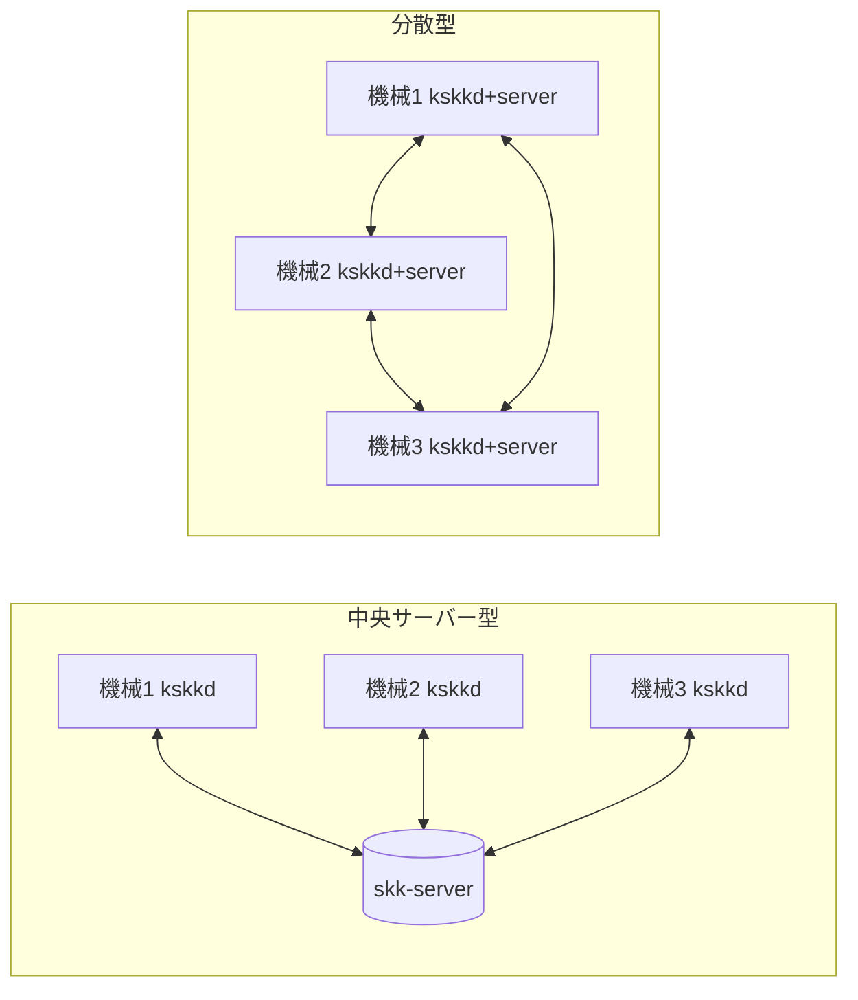

# 決定ページ: 同期の形 (中央サーバーか、分散型か)

- 日付: 2026-11-12
- 書いた人: skk-manager
- 状態: 1は決定 (所有者、2026-11-12、kstack-manager 経由:「skk, 同期はCで.」)。2と3は判断待ち

## 前提

1. 所有者は、学習の同期を「`yaskkserv2` のようなサーバー」とし、オフラインや切断のときのためにローカルのキャッシュが要る、と答えた (2026-11-06 の回答4。PLAN.md「Decisions waiting on the owner」4)。
2. 所有者は最初の段を「skk のserverとvim」とし、server は同期サーバーで、kskkd も要ると答えた (2026-11-12、kstack-manager 経由:「2: (イ) です。kskkdも要るとは思いますが。」)。
3. 所有者は新しい案として、分散型を挙げた (2026-11-12、kstack-manager 経由:「`yaskkserv2`とkskkdのペアについて、`分散型サーバー`の形もありかと思ってる」)。これは検討の依頼で、決定ではない。
4. 学習の記録は、機械ごとの追記だけのログである。同じ記録の集合なら、届いた順に関係なく同じ辞書になる。同じ記録の再送は1回として数え、同じ番号で中身が違う記録は拒む (ADR-0006、Proposed。jisyo の保存の契約、skk-jisyo#2)。このため、記録をどの経路で運んでもよい。
5. kskkd は機械ごとに1つで、その機械のログの唯一の書き手である (ADR-0009、Proposed)。
6. サーバーをどこで動かし、だれが辞書を読めるかは、まだ決まっていない (kskk#5)。

## 2つの形

## 選択肢

数字はすべて推定で、測っていない。

| 観点 | (a) 中央サーバー (Y0〜Y3 の案) | (b) 分散型 (各機械に server と kskkd の組) |
|---|---|---|
| 変わる ADR | ADR-0006 の方向のまま。ADR-0009 も変わらない | ADR-0006 を「中央サーバー」から「機械どうしで交換」に改める。ADR-0009 は、kskkd の外に、ほかの機械から受ける口が1つ増える |
| 競合 | 記録の規則 (前提4) で解ける。サーバーは記録をまとめて置くだけ | 同じ規則で解ける。中継する機械が増えるだけで、規則は同じ |
| オフライン | 手元のログで入力と学習は続く。サーバーに届かない間は、ほかの機械の新しい学習が来ない | 手元のログで続く。つながる相手が1台でもいれば交換できる |
| 動かす場所と、読める人 (kskk#5) | サーバー1か所を決めて守る。常に動いている機械 (VPS か自宅機) が要る | 常時動く機械は要らない。そのかわり、どの機械も外から受ける口を開く。Windows と Android でも開く |
| 相手を見つける方法 | サーバーの住所1つ | 機械の一覧か、発見の仕組み (同じ LAN、または VPN) が要る |
| 仕事の量 | Y0〜Y3: カード 8〜12 枚 | 加えて、相手の一覧、各機械で受ける口と認証、中継の試験: カード 14〜20 枚 |
| 最初に試すこと | 合成の記録で、2台の模擬機械がサーバー経由で同じ辞書になる | 3台の模擬機械が、どの組の順でつないでも同じ辞書になる。1台が切れていても同じ |

(c) 両方。まず (a) を作る。記録の規則は経路を問わないので、あとで (b) の口を足せる。Y1 のサーバーは、そのまま各機械の「受ける口」になれる。

## 推奨

(c) を推奨する。まず中央サーバー (a) で Y0〜Y3 を作り、分散型 (b) は後の段にする。理由は次の3つ。

- 記録の規則 (前提4) は、どちらの形でも同じである。
- (a) の Y1 は、(b) の各機械の受ける口として、そのまま使える。
- (b) は、Windows と Android で外から受ける口を開くことになり、認証と発見の仕事が先に増える。

Y0 の通信仕様には、中央を前提にしない形を入れる。具体的には、相手が中央サーバーか、ほかの機械かを区別しない。

## 決めてほしいこと

1. 同期の形: (a) 中央、(b) 分散、(c) まず (a) で後から (b)。推奨は (c)。
2. (a) か (c) の場合、サーバーを動かす場所の候補 (kskk#5): VPS、自宅の常時動く機械、ほか。
3. サーバーに辞書の検索 (skkserv、yaskkserv2 の役割) もさせるか、学習の同期だけか (前回の質問)。

答えを待つ間に止まるもの: Y0 (通信仕様) だけ。エンジンと Vim の段 (S1〜S6) と、jisyo のカードは止まらない。
