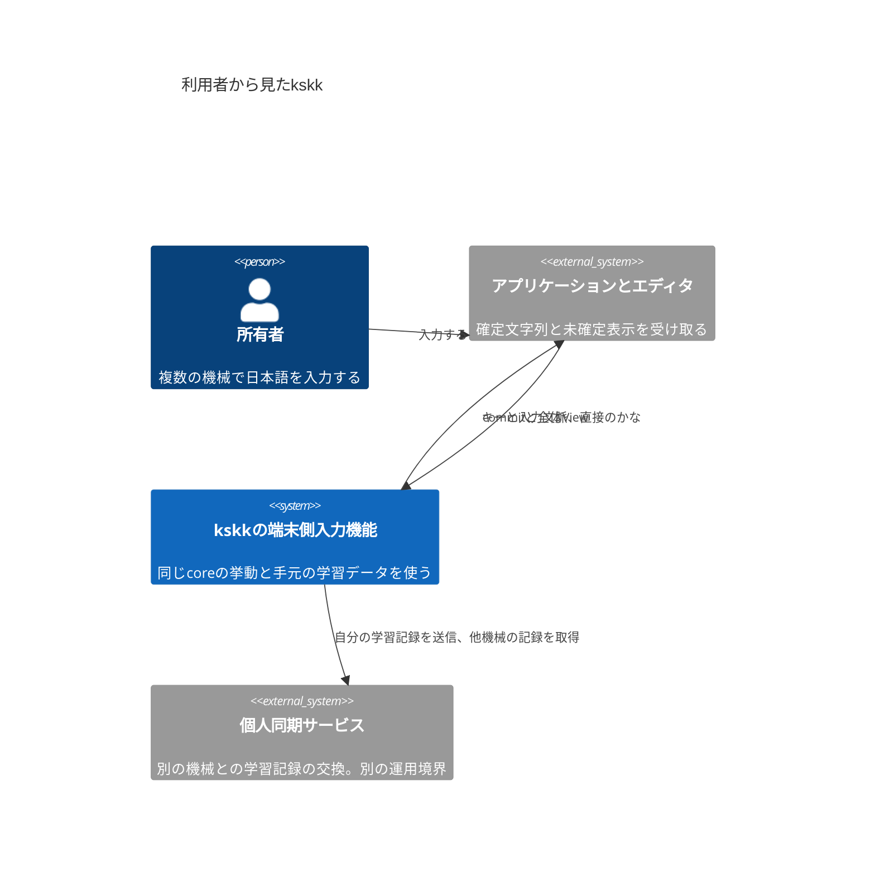
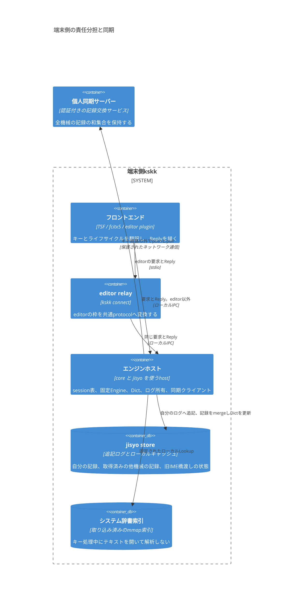
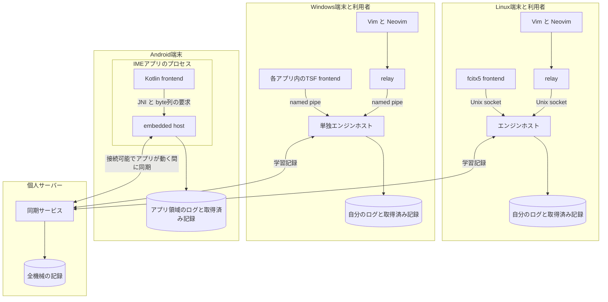
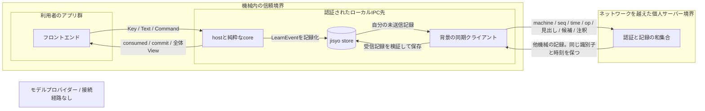
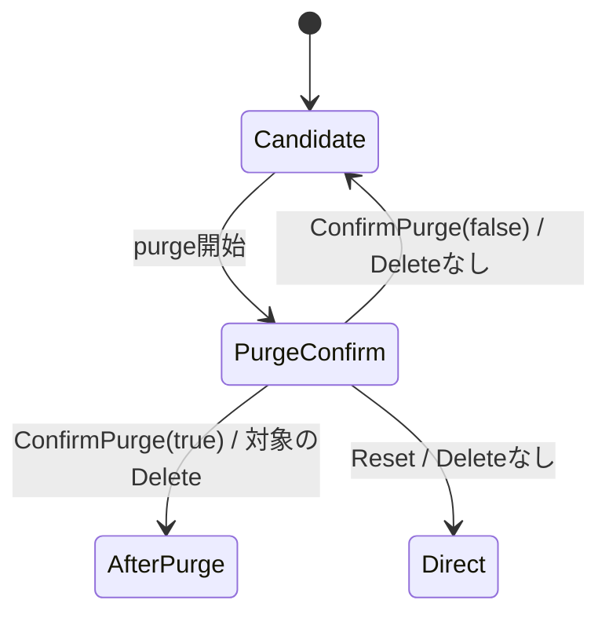

# kskkの設計セット

## 読み方と設計の状態

所有者が、各機械で何が動き、学習データがどこを通るかを確認するための文書である。これは稼働済みのシステムの構成図ではない。`kskkd`、`libkskk`、`kskk connect`は仮称である。

managerが採用したプランナー差分D1〜D8を、[ADR-0009](../adr/0009-architecture-and-events.md)、[ADR-0007](../adr/0007-editor-frontend.md)、[ADR-0004](../adr/0004-engine-choice.md)に反映した。各ADRはProposedのままである。プランナー原案の後半の修正を優先し、独自のLearn型、coreへの時刻引数、conformanceのconsumed追加は採らない。

## 目標と範囲外

目標は、Windows、Linux、Vim/Neovim、将来のAndroidで、同じ入力エンジンと同じ学習データを使うこと。classicはddskkの標準挙動、customは今は空の設定でclassicと同じである。Linuxはfcitx5を対象とする。これらのAcceptedな決定は変えない。

今回の範囲外は、独立したfrontendごとの変換エンジン、IBusの追加、remote検索をキー処理に直結すること、モデルによる変換、ユーザーの既存IME設定や実辞書を無承認で上書きすること。エンジンの採用先、同期の通信仕様とサーバーの配置、Androidの機種、Windows実機の試験経路は、この設計図だけでは確定しない。

## 品質目標

| 目標 | 設計上の手段 | 検証と限界 |
|---|---|---|
| 打鍵ごとに待たされない | 同期の要求とReply。Lookupはローカルのみ。ネットワーク同期はキー経路から外す | editorはADR-0007のp99が10 ms以下という基準を維持する。これは推定: 採否基準であり、計測値ではない。V3はrelayを先に測る。fcitx5はV6で実用遅延を検証し、Fカード前に採否条件を固定する |
| 学習した語を失わない | hostが自分のログを単独所有し、seqとtime、追記、保存結果を管理する。削除も記録に残す | 保存成功と応答、再起動、部分末尾、同時起動を検査する。未確認の操作や未確定preeditまで復元できる保証ではない。電源断の保存境界を実機で確認する |
| オフラインでも使う | 自分のログと取得済みの他機械の記録を手元に保持する | サーバー停止中も入力と追記を続ける。他機械の未受信の学習は再接続まで見えない |
| 同じ挙動を保つ | coreを純粋なState/Input/Lookupからの遷移にする。TextとCommandも同じ意味処理へ入れる | conformanceのtext/preedit/modeで比較し、独自エンジンのadapterも出荷するhost経路を通す |
| 設定や境界を差し替える | Engineは生成後不変。hostが共通設定を検証し、新しいEngineとsessionのResetへ切り替える | 設定変更をcoreの生イベントにせず、frontendごとの解釈を避ける。不正な設定は旧Engineを壊さない |

性能、メモリ量、起動時間の計測は今回していない。図のプロセスやデータの個数は配置の指定であり、利用状況や資源消費の測定結果ではない。

## C4 context: 利用者と外部との関係

入力機能の外にあるアプリケーションと、別の運用境界にある個人同期サービスとの関係だけを描く。同期サービスは学習記録の保存・交換を行う設計対象であり、既存のyaskkserv2がそのまま書き込み同期を提供するという意味ではない。

## C4 container: 責任とデータの所有

ここでいうcontainerはC4の実行・配置単位であり、Docker containerを要求するものではない。coreはhostに含まれるライブラリで、独立したdaemonではない。図は通常のデスクトップ配置を示す。

- LinuxとWindowsでは同じ機械・利用者のhostが単独の書き手になる。hostの重複起動と、CLIによる並行した直接追記を禁止する。
- Stateは入力文脈ごとに分け、Dictはhostで共有する。他sessionのStateを混ぜない。辞書の差し替えはstepの間に行う。
- frontendはLearnEventを受け取らない。内部イベント列をhostが畳み、返事は常にconsumed、commit、全体Viewとする。
- 管理用の設定・取り込み・同期の口は、入力用protocolから分ける。表示用APIを任意ファイルの読み書きAPIにしない。

## Deployment: どの機械で動かすか

同じsourceから作るhostを配置し、各機械は自分のログだけを生成する。AndroidのhostはIMEと同じプロセスに入る。デスクトップと同じ常駐性を期待しない。

V1、V3、V6の失敗時には、該当platformでembedded hostとfile lock/log tailを使う代替を検証する。通常配置と代替のログ所有権を同時に使わない。NeovimのFFI比較も、同じkskk_callの要求とReplyを運ぶだけで、別の変換エンジンは作らない。

## Data flow: 信頼境界を越えるもの

ローカルIPC境界と、ネットワーク越しの同期境界を分ける。学習記録には見出し、候補、注釈が含まれるので、「キー列を送らない」ことは「辞書の文字列もサーバーへ届かない」という意味ではない。

モデルプロバイダーへの矢印はない。キー、preedit、commit、辞書、学習記録を推論APIやtelemetryへ送る経路を設けない。開発時にモデルが読むのはsourceと合成fixtureであり、所有者の実辞書の内容ではない。

サーバーへ送るのは記録であり、任意のアプリの周辺文脈や生のキー履歴ではない。暗号化と認証は実装前の必須条件とするが、通信形式、credentialの配置、サーバーの設置先、誰がサーバー上で辞書を読めるかはADR-0006の残る判断である。エンドツーエンド暗号化や署名を実装済みとは扱わない。

## 確認状態の流れ

purge確認の問いはOSやエディタに任せず、engineのStateとPreeditで描く。設定による無条件の自動承認はしない。自分たちのconformance adapterだけが、試験用に明示した肯定要求を送る。

AfterPurgeは削除の確認を完了した状態を示す。確認後の具体的な入力表示はclassicのケースで固定する。試験用hostはケースごとの一時storeと合成辞書で動き、実稼働daemonや同期サーバーへ接続しない。adapterはpurge-confirmationという役割だけを検出して内部のConfirmPurge(true)を送り、最後のViewをtext/preedit/modeへ写す。登録中のpromptへ勝手に回答せず、既存のconformance protocolやケースのキーを変えない。

## 短い脅威モデル

| 境界・入力 | 起き得ること | 設計要求と残る危険 |
|---|---|---|
| 同じ利用者のプロセスから届くsocket/pipe要求 | 別sessionの閲覧、なりすまし、巨大な要求や大量接続、学習の汚染 | OSの接続元を確認し、sessionを接続に結び付ける。要求の長さと資源・期限に上限を置く。入力用の口からファイルや設定を操作させない。同一利用者の悪意ある全プロセスから辞書を完全に隠す設計ではない |
| LinuxのendpointとWindowsのpipe | 別利用者の接続、endpointの差し替え、権限を広げ過ぎたACL | 利用者専用の置き場所と接続元の照合、限定したpipe DACLを使う。入力用IPCをネットワークへ公開せず、pipeのremote接続も拒否する。Linuxの根拠は [unix(7)](https://man7.org/linux/man-pages/man7/unix.7.html)、Windowsは [Microsoftのpipe権限](https://learn.microsoft.com/en-us/windows/win32/ipc/named-pipe-security-and-access-rights)。AppContainerを含む実効権限はV1で確認する |
| 同期サーバーと通信 | 辞書の漏えい、不正な記録、再送、同一IDの衝突、不完全な記録集合 | 認証と通信の保護、受信検証、同一IDの内容差の拒否、元の時刻の維持、ローカルログの保持。悪意のあるサーバーに対する完全性や、未配信の記録の不存在を証明する保証はまだない |
| システム辞書と取り込みファイル | 不正な文字コード、壊れた候補、式の実行、巨大な入力、古いIME内容による削除の拡散 | 読込みと索引作成は明示した取り込み経路で行い、形式と大きさを検証する。任意のLispを実行しない。旧IME橋渡しではrestore/delete guardを維持する。実ファイルへの書込みは承認後だけ |
| hostの停止、満杯のdisk、途切れたログ | preeditの消失、応答と保存の食い違い、二重起動の競合 | 確認済みの学習はローカルの保存済み記録から復元する。保存失敗を成功にしない。部分末尾を報告し、復旧せずに追記しない。輸送の再送とアプリへのcommit適用を区別する |
| 診断・開発ツール・モデル | IPC dumpやerrorへのキー・辞書・注釈の混入 | 通常の診断は件数、位置、エラーコードだけ。生の要求やReplyを記録しない。モデルへの送信はない。合成データで問題を再現する |

ここに書いた対策が実装済みという意味ではない。特にsocket/pipeを開く最初のKカードには、認証、session所有、入力上限、拒否経路を各々の試験とguard確認として載せる。

## 今回は確定しないものと次の検証

- V1はWindowsの保存先とAppContainer/pipe、V2はTSFのキー消費、V3はeditor relay、V4はAndroidのcommitとキー順序、V5は採用候補のAPI、V6はfcitx5の同期IPCである。V1/V2はWカード前、V3/V6は該当frontendの初期カードで検証する。
- WindowsとAndroidの動作を、古いcross buildやcargo checkだけで確認済みとしない。材料の範囲はADR-0004に記した。
- First sliceのS0では[embedded JSON契約](s0-embedded-protocol.md)を先に固定する。framing上限、認証、起動時のログ所有lock、接続とsessionの所有、deadlines、要求IDと再送は、socketを開くS5へ分ける。保存の障害モデルはstoreを使うS7で検証する。
- PLANとoverviewの配置記述、jisyo/SPEC.mdのログ所有者の記述は、managerとjisyo leadの更新対象である。今回の変更範囲には含めない。
