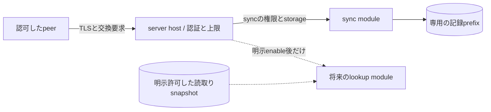
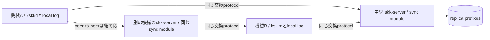

# Y0: skk-serverのモジュール境界と記録交換

- 状態: Proposed。設計案であり、実装・通信試験・運用承認を済ませたという意味ではない
- 日付: 2026-11-12
- 対象: PLANのserver track Y0。停止前の引継ぎ用。workerもサービスも起動しない

## 1. 決定済みのことと、この案が決めること

所有者の回答を、そのまま記録する。経路はkstack-managerからskk-manager、出典は[同期の決定ページ](../decisions/sync-topology.md)。

> skk, 同期はCで.

> make it as a `module` system.

> 最終的にはremote の VPSか、tailscaleで繋がったraspberry pi

> 開発中は boiledに置きます

Cは中央サーバーを先に作り、peer-to-peerを後から足す選択肢(c)である。開発場所はboiled。本番のVPS/Piのどちらか、または具体的な業者・機種は未決定。module systemを採ることは決定済みだが、下のstatic registration、TLS、wire形式、保存方式は技術提案であり、所有者が個々の方式まで承認したとは扱わない。

記録の根拠はskk-jisyo commit `776f663820e68c1b712393248e035fe45b95edfa` のSPEC.md、Record、Merge、Store、Server-exchange boundaryである。参照したローカル写しは `local/agents/skk-design-Y0-jisyo-SPEC-776f663.md`。local main/origin/mainがそれより古かったため、fetchせず指定commitから取り出した。

変更しないものはLearnEvent、LogRecord、機械内の単独書き手、mergeの `(time, machine, seq)` 順、Noneと空の注釈の区別である。サーバーは新しい学習を生成せず、受信時刻を付け直さない。skkservの検索は同期に混ぜず、後の別moduleにする。

## 2. moduleとは何か

最初は、同じRust workspaceでビルドする信頼済みcomponentをmoduleとする。任意の共有libraryやスクリプトをdirectoryから自動発見・実行する方式ではない。Rustのtrait署名、crate構成、依存のpinは、再開後のserver担当がSPECとカードで定める。

| 境界 | 所有するもの | 所有しないもの |
|---|---|---|
| Server host | listener、TLS、認証、module別権限、入力上限、起動排他、module registry、診断 | SKKの変換規則、記録の時刻・seqの採番 |
| sync module | 以下の交換protocol、prefix検証、重複・衝突判定、module専用のreplica保存 | 候補検索、IME export、実辞書、local own logへの学習追記 |
| 将来のlookup module | 検索protocolと、明示的に渡された辞書snapshot/index | syncの追記・ack・削除記録の変更、syncの認証の迂回 |
| kskkdの同期client | 手元の未配信記録の送信、取得・検証・cache公開、peer別の進捗hint | network待ちをキー処理に入れること、他機械名での学習生成 |

起動は、設定の読込み、既知のmodule名・versionと権限の検査、専用data directoryの単独所有、module生成、route登録、最後にlistener公開の順。最初のregistryはsyncだけを登録し、設定でenableする。未知のmodule、重複route、不正設定ではlistenerを開かず失敗する。hot reloadやwire経由のmodule installは入れない。

hostはmoduleへ、認証済みprincipal、許可された操作、専用replica storage、期限・上限、内容を含めない診断の入口だけを渡す。moduleはcredential/CA秘密鍵、ほかのmoduleの保存領域、ownerのIME設定・実辞書、kskkdのown logを直接開かない。必要な追加権限はmanifestとカードに明示する。受信したURL、ファイルパス、module名から新しい接続先や実行対象を作らない。

これは同一process内の設計上の境界であり、悪意のあるnative moduleをOSから隔離するsandboxではない。layer検査とcode reviewで直接のfile/networkアクセスを制限する。信頼できない第三者pluginが必要になったら、別process/Wasm等を別途設計する。

lookupを足す場合も、syncはlookupを呼ばず、lookupに依存しない。共有が必要ならhostが権限付きの読み取りsnapshotを渡す。legacy skkserv用listenerを足すことや、同期記録を検索へ公開することは自動的には許可されない。listener、認証、辞書sourceの別契約が要る。



## 3. peerと認証・暗号化

初期版は、instanceごとに所有者の記録集合をひとつ扱う。公開multi-tenant serviceは作らない。各受信先は独立したpeer IDを持つが、それはrecord.machineとは別で、中央の権威を表さない。

提案はHTTP/1.1とTLS 1.3以上、相互TLSである。認証はhostが行い、moduleはHTTPの自己申告identity headerを信用しない。最初はTLSをhostで終端し、reverse proxyへの委譲はしない。TLSの実装・cryptoは検証されたlibraryを使い、自作しない。採用crateとoffline build可否は未確認。

- 所有者管理のCAがpeerごとのleaf証明書を発行する。serverへ置くのは自身のleaf秘密鍵と公開trust情報で、CA秘密鍵を配らない。
- clientはCA、証明書期限、接続先DNS/IPのSANを検査する。localhostも試験用のCA/SANを使う。検査を無効化してVPS/Piの違いを吸収しない。
- receiverはclient証明書と、DER形式のSubjectPublicKeyInfoのSHA-256として登録した公開鍵fingerprintのallowlistを照合する。権限はsync:read、sync:write。証明書の期限と権限は要求ごとに再検査し、失効した接続を使い続けない。TLSの時刻検査を、record.timeの書き直しに使わない。
- 認可対象のmachine ID一覧も設定で登録する。未知のmachineは保存領域を作る前に拒む。登録・失効は管理操作であり、このwire APIに含めない。
- TLS principalをrecord.machineと同一視しない。write権限を持つpeerは、登録済みmachineの既存記録を中継できる。自身の記録を新規生成できるのは、そのmachineのローカルlog ownerだけである。

認可されたpeerは記録を読め、改ざんした記録を先に投入する能力も持つ。TLSは元の機械による署名ではない。server管理者/VPS管理者から本文を隠すE2E暗号化も、この初期案にはない。承認済み記録との衝突は検出するが、悪意ある認可peerからの来歴・完全性を暗号学的に保証するとは言わない。これを許容できない場合、実データを送る前に署名またはE2E案へ戻る。

## 4. 交換protocol v1

これはhostのmodule用endpoint `/modules/sync/v1/exchange` に対するPOSTのJSONである。media typeはapplication/json、UTF-8。返事はCache-Control: no-storeとする。TLS認証・操作権限を検査してからmoduleへ渡す。sync自体に検索命令やpeer URLを渡す命令はない。

要求と返事は単独のJSON object。全要求でprotocol: integerの1とtype: stringが必須。未知のtype/field、重複field、型違い、非UTF-8、孤立surrogate、非有限数値はbad-request。protocolが対応しなければprotocol-mismatch。booleanをintegerとして受けない。

seq位置のafter、throughは、0または先頭0のない十進stringで、u64範囲内。recordのseqは1始まりだが、位置0はheaderだけのprefixを表す。machineはjisyoの `^[a-z0-9][a-z0-9-]{0,31}$`。prefix_hash/base_hashは小文字hexのSHA-256である。

### 4.1 正規形とhash

通信するlogはrecord行のUTF-8文字列で、headerを含めない。各行はjisyo::format_recordの出力にLFを足した正規形である。JSONではtab、backslash、LFをJSONの規則でもescapeする。復号後のrecordのlog escape規則はjisyo SPECのまま。独自のLearn型を設けない。

prefix nのhashは、`jisyo-log 1\n` とseq 1〜nの正規record行を連結したbytesのSHA-256。hashは比較の補助で、recordのIDや出所の署名ではない。比較対象はmachine、seq、time、op、section、midashi、okuri、candidateの全体であり、注釈のNone/空文字を丸めない。

prefix 0のhashは `751d9b275968e738200bf53df63a7fa8566e0ae50fe57d84aeb89944dd429cec`。これらは合成例の独立計算で、server実装の合格結果ではない。

### 4.2 操作と返事

| type | 要求の追加field | 正常な返事と意味 |
|---|---|---|
| hello | なし | type: hello、protocol: 1、peer: 空でないID、log_format: jisyo-log/1、max_body_bytes/max_records: 正のinteger |
| heads | なし | type: heads、heads: machine/through/prefix_hashのobject配列。登録machineをASCII順に並べ、空も位置0として含める |
| push | machine、after、base_hash、through、log | type: pushed、machine、through、prefix_hash。今回のthroughまでを同じ内容で永続化したack |
| pull | machine、after、base_hash、limit: 正のinteger | type: pulled、machine、after、through、prefix_hash、log、more: boolean。afterの次からの不足suffixだけを返す |

操作の権限はhello/heads/pullがread、pushがwrite。通常の同期clientにはreadとwriteの両方を与え、read-only clientは取得だけに使う。write-onlyの交渉clientは初期範囲に含めない。初期版のclientはhelloでprotocol、format、上限を確認する。peerは設定と証明書のidentityに結び付け、返されたpeer IDだけで認証したとは扱わない。server、master、leaderを示すfieldは使わない。将来peer同士が双方の要求を送る場合も同じ規約を使う。

pushはthrough > after、logはちょうどseq after+1〜throughの完全な行。pullはreceiverの安定したprefixから最大limit件を切り出し、through = after + 行数とする。afterが現在のheadなら空log、through=after、more=false。throughより後に記録があるときだけmore=true。並行追記があっても、ひとつの返事はひとつの検証済みprefixから作る。

初期の上限はHTTPの符号化後body 1 MiB、1回256 record、登録machine 64件、要求期限10秒を提案する。すべて推定: 測定値ではない初期設計値。圧縮bodyは受けない。送受信側とも自分の上限を持ち、相手の広告値が大きくても超えない。pullの返事も符号化後のbody上限内で、完全なrecord境界で区切る。受信側の上限に収まらなければclientはlimitを下げて再取得する。recordひとつが上限を超えたら、欠落・切捨てで続けずlimit-exceededとして停止し、上限の見直しを行う。期限はclientの接続開始からTLS、HTTP、ack本文の受領までを数える。timeoutは受信側の保存を取り消す命令ではなく、遅れて保存済みとなった場合も同じIDの再照合で扱う。

### 4.3 pushの受入れとack

machineごとのpublication lockを取り、最新の既存prefixに対して以下を行う。

1. 認証・権限、登録machine、body/行数上限、after/through、行のmachineとseqの一致、完全なLF終端を検査する。
2. receiverがafterまで持たない場合はneed-prefix。持つ場合はそのprefixのbase_hashを比較する。不一致ならprefix-mismatchとして何も公開しない。これはまだ特定IDの内容差の証明ではない。
3. 既存prefixと重なるIDの正規record行を比較する。同一なら再送で、追加件数へ数えない。内容差があればlog-conflict、上書きしない。legalなwire recordでは正規形が同じこととLogRecordが等しいことは一致する。
4. 重なりを除いたsuffixを既存prefixへ組み合わせ、headerからjisyo::parse_logで検証する。partial_tail=false、seq欠落なし、timeの厳密増加、event fieldと正規形の一致を要求する。既存の承認済みrecordを残したcomplete prefixだけを候補とする。
5. 候補を別ファイルへ書き、file sync、同じdirectoryでatomic rename、directory syncまで成功してから公開済みprefixとする。ackはそれから返す。重複だけの場合も、同じprefixの永続性を確かめてからackする。

validationとlog-conflictではbatch全体を不適用とし、一部だけ追加して成功させない。I/O失敗では旧prefixまたは完全な新prefixが残り得るが、partialな公開はしない。ackを返さず再送可能にする。永続性が不明なmachineはheads/pullの成功対象にせず、再検証とfile/directoryのbarrierが成功するまでioを返す。headsでもそのmachineを黙って省略せず、要求全体をioにする。同じdirectory内でのatomic publicationが使えない保存先では稼働させない。

ackのthroughは要求された位置そのもの。receiverがもっと先を持っていても、その先まで今回確認したことにはしない。senderはmachine、through、prefix_hashを、自分が送ったprefixと照合してから、そのpeerへの送信進捗hintを進める。ackでown logから消さず、辞書の削除とも解釈しない。

### 4.4 pullとlocal cacheの公開

pullもafterのbase_hashを確かめる。足りない場合はneed-prefix、不一致はprefix-mismatch。成功時は既存部分を再送せず、次のseqからだけ返す。receiverは返事全体をstagingへ受け取り、machine/after/through/行数/上限を検査し、手元のprefixと組み合わせてparse_logとhashを検証する。その後、上と同じfile sync/rename/directory syncでcacheを公開する。network待ちの後にpublication lockを取り直し、その時点の最新prefixとの重なりを再比較する。hashは応答のthroughまでについて検査し、手元がすでにその先を持つ場合も既存recordを切り詰めない。

HTTP途中切断、壊れたJSON、欠落行、partial_tail、hash不一致では、たとえ途中まで完全なrecord行があっても公開しない。完成したchunkなら、そのthroughまでを完全なprefixとして公開してよい。more=trueは、それ以降が未取得という意味であり、このchunkが部分末尾であるという意味ではない。

自機のown logはdownload側から延長・復元・置換しない。peerに同じmachineの、自分にないseqがあればID再利用か履歴喪失を疑い、recovery-requiredとして停止する。別契約なしにseqを巻き戻したり、machine名を付け直したりしない。

kskkdでのcache公開はlog ownerへ直列化して依頼する。network待ちの間はkey処理のlockを持たない。Lookup/Dictは公開済みsnapshotだけを使い、stepの間で差し替える。既存のwrite_atomicだけでdirectoryの耐久性まで確認済みとみなさず、受信adapterの公開処理で必要なbarrierを実装・試験する。

### 4.5 同じIDの衝突とhash不一致

log-conflictは、同じ(machine, seq)に別内容があった結果である。自動的なlast-write-wins、受信時刻の採番、相手が中央だから上書き、は行わない。対象の交換を停止し、既存データを保つ。

prefix-mismatchは、まず位置0からのprefix照合へ戻す。完全なchunkごとに既存IDと比較し、内容差が分かった時点でlog-conflictにする。検証済みrecordを消して相手のprefixへ置き換えない。新規recordの正規形違反はinvalid-logとして拒み、異なる表現を別の学習として数えない。複数違反がある場合は4.3の検査順を採り、既知IDとの内容差はstep 3のlog-conflictを先に返す。

### 4.6 エラー

bodyはtype: error、codeと、検証済みの安全なmachine/seqだけ。seqが確定しないエラーではseqを付けない。値、注釈、log行、証明書秘密鍵、例外の生文面を返さない。

| HTTP | code | 処理 |
|---|---|---|
| TLS拒否 | JSONなし | 証明書・信頼関係が不成立。moduleを呼ばない |
| 403 | forbidden | module権限またはmachine登録がない。データを返さない |
| 400 | bad-request / protocol-mismatch / bad-machine-id / invalid-log | 不正形・形式。再送を繰り返さず修正する |
| 409 | log-conflict | 既存prefixを保ち、自動再試行を止める |
| 409 | prefix-mismatch / need-prefix | prefixを先頭から照合する。承認済み記録は消さない |
| 413 | limit-exceeded | 小さいchunkへ分ける。単recordでも超えるなら止める |
| 503 | io | 永続化未確認。ackなしで、同じIDを後で再送する |

エラー判定順は認証/権限、上限とJSON形、machine/seq、base prefix、重複ID、完全prefixの検証、保存とする。存在しないmoduleや許されない操作から、他moduleのdataの有無を調べられないようにする。

## 5. 合成の交換例

次の要求のlogはheaderなし、復号後はtab区切りの1行。元のtime 10はreceiverが変更しない。

```json
{"protocol":1,"type":"push","machine":"a","after":"0","base_hash":"751d9b275968e738200bf53df63a7fa8566e0ae50fe57d84aeb89944dd429cec","through":"1","log":"a\t1\t10\tadd\tnasi\tsample\t\tA\n"}
```

```json
{"type":"pushed","machine":"a","through":"1","prefix_hash":"553f7ee08d94123423b55610440ae04766edebc55e37c3766cf374ee346fc50c"}
```

```json
{"protocol":1,"type":"pull","machine":"a","after":"0","base_hash":"751d9b275968e738200bf53df63a7fa8566e0ae50fe57d84aeb89944dd429cec","limit":1}
```

```json
{"type":"pulled","machine":"a","after":"0","through":"1","prefix_hash":"553f7ee08d94123423b55610440ae04766edebc55e37c3766cf374ee346fc50c","log":"a\t1\t10\tadd\tnasi\tsample\t\tA\n","more":false}
```

```json
{"type":"error","code":"log-conflict","machine":"a","seq":"1"}
```

## 6. ack喪失・再試行・再起動

- 起動・再接続、新しいlocal recordの永続化で背景の交換を予約する。新規記録がないときのpoll間隔は推定の初期値60秒とし、成功直後にheadsを回し続けない。相手のURLは管理設定だけから取り、返事やHTTP redirectから新しい送信先を採らない。
- ack喪失時は同じIDと同じ本文を再送する。専用のrequest UUIDやexactly-once deliveryを仮定せず、record identityで重複を消す。
- 送信位置と取得位置はpeerごと・machineごとのhintである。接続し直したらheadsとprefix hashを照合する。以前のackだけを信じて新peerや復元後のpeerへの再送を省かない。
- 再起動時は完全prefixを検証してheadを復元する。未公開のstagingファイルはrecordとして読まず、部分末尾のある保存済みprefixは勝手に修復して先へ進めない。確認・復旧できるまで成功ackを出さない。
- 推定の初期運用値として、I/O/切断/一時不通の再試行間隔は1、2、4、8、16、32、60秒までのbackoffとし、最大でその間隔の4分の1のjitterを足す。成功した交換で戻す。Clock/jitter sourceは試験で注入し、sleepをcoreへ入れない。
- 認証失敗、権限不足、log-conflict、recovery-requiredは自動再送loopにしない。期限切れは未配信確定ではなく成否不明なので、記録を保持して再照合する。
- own log、取得済みrecord、Deleteをack後も保持する。未受信recordの存在や、悪意あるpeerによる欠落を証明できる仕組みはまだない。同じrecord集合へ到達した場合の辞書一致を保証するもので、切断中の即時一致ではない。

## 7. 保存と配置

初期backendはmodule専用のmachine別prefixファイルとatomic publicationを推奨する。全prefix書き直しは推定でO(prefix bytes)のI/Oとなり、巨大な履歴には不利だが、破断したsuffixを公開しない手順を単純にできる。heads/hashは公開済みprefixから導き、別manifestだけが先行する状態を作らない。SQLite等への変更は同じwire/ack契約を守って後からできる。

hostはdata directoryにprocess単位の排他を取り、同じ領域を使う2個目はbind前に失敗させる。module内ではmachineごとに更新を直列化する。client入力をそのままpathへ結合せず、登録済みmachineとhostのstorage handleだけを使う。data/staging/key領域はservice専用とし、他利用者やsymlinkによる差替えを許さない。暗号化backupと復旧は必要だが、保存先と許容損失は所有者の運用判断として残す。



| 環境 | 配置の条件 | まだ確認していないこと |
|---|---|---|
| localhost試験 | 127.0.0.1/::1の一時port、Temp内のdata/CA/key、合成record。外部へ接続しない | 実TLS、切断注入、disk障害の試験は未実施。通常unitと明示的loopback統合試験を分け、外部networkを許可しない |
| boiled開発 | 同じbinary/config形式で専用service dataを使う。既定bindはloopback。実際に起動・外部公開する前に明示確認 | 現在のIME/編集設定へinstallしない。今回は起動していない |
| remote VPS | endpoint、証明書、disk、backup先を設定で差し替える。公開するならhost/firewallで認可した接続だけにする | 業者、費用、管理者からの読取り、backup運用は未決定 |
| Pi on Tailscale | tailnet内の指定hostname/IPにbindし、TLSとmodule認可も使う。Tailscale参加だけを権限とみなさない | ARM build、SD/SSDの耐久性、電源断、常時接続と復旧は未確認 |

配置先をprotocol fieldや条件付きcompileへ埋め込まない。VPSとPiの双方で、同じrecord、同じ認証policy、同じ再送規則を使う。boiledからの移設は、停止・prefix検証・backupからの復元・endpoint/certificate更新を明示して行い、古いack hintだけで同期済みとしない。

## 8. 開いた技術選択と費用

以下は全て推定で、実測値や見積書ではない。既決の中央先行・module化・boiled開発を選び直す表ではなく、実装方式の比較である。

| 選択 | 初期提案と費用 | 代案と費用・切替条件 |
|---|---|---|
| moduleのload | static registry＋設定enable。推定: 配布物が単純、追加時は再build/restart | dynamic library/Wasm/別process。推定: ABIまたはRPC、署名・隔離・障害管理が増える。第三者pluginが要る場合に別設計 |
| transport | HTTP＋TLS。推定: framing/暗号をlibraryへ任せられるがcert運用が要る | 独自TCP framing。推定: byte数を減らせる可能性はあるが、上限・再試行・暗号境界を自分で実装する |
| 認証 | mTLS＋公開鍵allowlist。推定: 配布/失効の手間、requestごとの共有password不要 | TLS＋device bearer token。推定: 実装は軽いが、token保管・漏えい・rotationが要る。Tailscale identity連携はprovider依存が増える |
| 永続化 | machine別file＋atomic prefix公開。推定: 部品が少ないがprefixサイズに比例する書込み | SQLite。推定: incremental transactionに有利だがu64 seqの表現、schema migration、依存の検査が増える |
| 受信の単位 | complete prefixをchunkごと検証。推定: 再送とhash計算は増えるがgap/partialを拒める | 疎なrecord集合＋range索引。推定: 大きな欠落に柔軟だがprefix組立てと公開規則が複雑になる |
| 本文の秘密性 | TLS＋service権限。推定: sync検証と将来lookupが容易。管理者には本文が見える | E2E暗号化。推定: key配布・復旧が増え、server側の内容検証/lookupをそのまま使えない |
| 元のproducerの証明 | 認可memberを信頼。推定: 少ない部品で中継可能、改ざん済みmemberの偽造は防げない | record署名envelope。推定: canonical bytes、producer鍵の更新・失効・復旧を追加し、LogRecordとは別に保持する |
| 進捗 | peer/machine別prefix hash。推定: 比較にI/Oが要るが中央のcursorを仮定しない | Merkle/range summary。推定: 大規模には効く可能性があるがhash構造とrepair protocolが増える |
| 実運用先 | VPS。推定: 月額・公開面の保守、常時稼働の管理を外部へ寄せられる | Pi＋Tailscale。推定: 機材・電源・回線・storage・tailnet管理が必要。実費/可用性は未計測 |

## 9. 所有者が実運用前に決めること

1. 最後のhostをVPSかPiのどちらにするか。候補の実費と常時稼働条件を調べてから選ぶ。boiledでの開発は決定済み。
2. VPS/端末の管理者と認可した全peerが辞書本文を読める初期案でよいか。認可deviceの偽造まで防ぐ署名、またはE2Eが必要なら、実データ送信の前に戻す。
3. 登録するdevice/machineと権限、CA/backup keyの管理者、backup先、復元時の許容損失。所有者だけの運用を初期値として提案するが、他人と共有する承認は含めない。

中央から始めるか、module化するか、開発場所をどこにするかは再質問しない。技術案の変更は性能・復旧試験の結果から担当者が提案する。今回はskk停止前の設計保存であり、これらの回答やworker起動を今求めない。

## 10. 再開後に確認する項目

Y1/Y2/Y3の各カードでは、同一再送、同一IDの異内容、gap、時刻逆行、None/空注釈、受信時刻でのrestamp禁止、ack前の永続化失敗、ack喪失後の再送、途中切断、他machineの中継、own logの延長拒否を、それぞれ独立した公開API試験にする。expectedはliteralな合成recordsから決め、serverの出力を期待値に使わない。

さらにmodule名/route衝突、他module領域へのアクセス拒否、失効peer、認可前のdata非公開、body上限、malformed UTF-8、path差替え、再起動、boiled/VPS/Pi相当の設定差、3 peerで接続順を変えた収束を確認する。負荷試験ではprefix書直しとTLS/fsync時間を測り、上限とbackoffを調整する。悪意ある認可peerやhardware故障まで解決済みとは扱わない。

この文書だけでY0の曖昧性レビューが済んだことにはしない。再開前の設計・仕様レビューと、実装前のカードを残すが、このturnにworker、server、peer-to-peerの実装や運用を開始しない。
