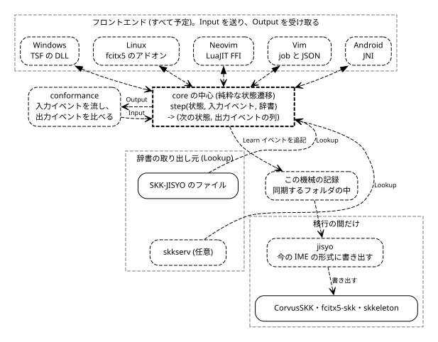
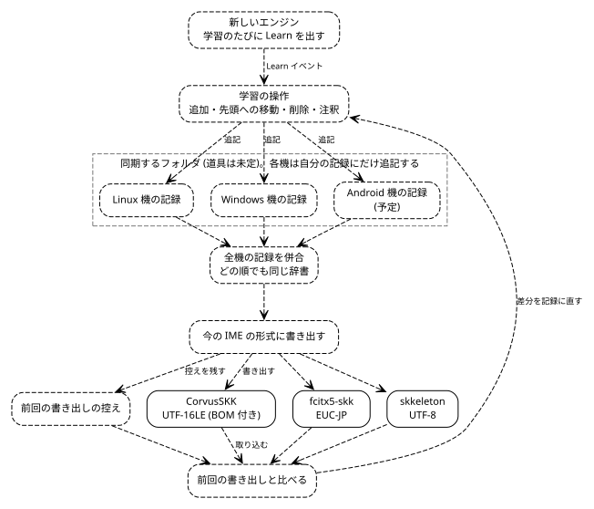
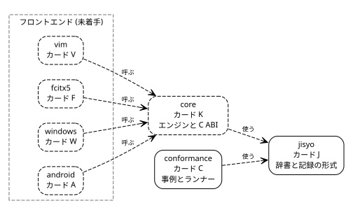
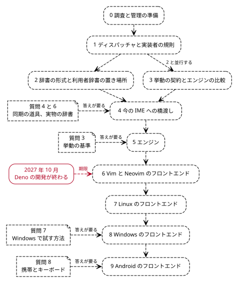
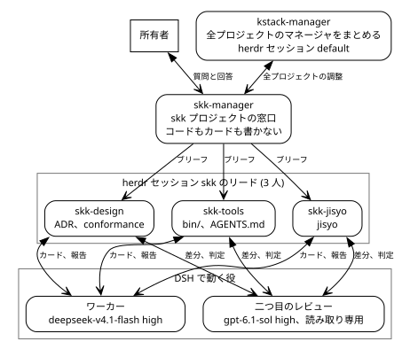
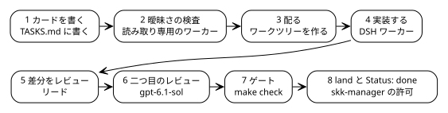

# SKK を1つのエンジンにまとめる

> 2026-11-06 時点の文書です。この後に届いた問い3、4、6 の回答 (`classic` と `custom` の2つのモード、yaskkserv2 のようなサーバーと手元のキャッシュによる同期、本物の辞書のコピーを件数だけで使うこと) と、リードを DSH で動かす変更は、ADR-0002 と ADR-0006 を見直した後に反映します。

## 目的は1つのエンジンで、2つの問題が計画の形を決める

目的は、Windows、Linux、Vim/Neovim、将来の Android で、同じ SKK の挙動と同じ学習データを使うことです。
問題は2つあります。
Deno の開発が2027年10月ごろに終わるので、その上で動く skkeleton を置き換える必要があります。
どの実装も辞書ファイル全体を書き直すので、1つのファイルを機械の間で共有すると学習が消えます。
答えの形は3つです。Rust のエンジンを1つ作り、各機のフロントエンドを薄くし、機械ごとの追記専用ログを併合して辞書を作ります。

## 今の3つの環境は、それぞれ別のエンジンと別の辞書を使っている

所有者がいま使っている3つの環境を、実装、エンジン、利用者辞書の場所、文字コード、置き換え先の順に並べます。実装の版と場所は `docs/research/README.md` (2026-11-06) によります。

| 環境 | 実装 | エンジン | 利用者辞書 | 文字コード | 置き換え先 |
|---|---|---|---|---|---|
| Windows | CorvusSKK 3.3.4 | TSF に埋め込み | `%APPDATA%\CorvusSKK\userdict.txt` | UTF-16LE (BOM 付き) | `windows` (予定) と `core` |
| Linux | fcitx5-skk 5.1.11 | libskk | `~/.local/share/fcitx5/skk/user.dict` | EUC-JP | `fcitx5` (予定) と `core` |
| Vim/Neovim | skkeleton 3.0.0 | 本体 (Deno) | `~/.skkeleton` | UTF-8 | `vim` (予定) と `core` |

`README.md` は Linux の実装を ibus-skk と書いていますが、この機で動いているのは fcitx5-skk です。どちらも libskk を使うので、調査の結論は変わりません。
`fcitx5` リポジトリは、エンジン ADR (0004) が cskk を選び、fcitx5-cskk で Linux をまかなえるなら作りません。



図 1. エンジンの中心が入力イベントを受けて出力イベントを返し、辞書を `Lookup` で引き、学習を機械の記録に追記する形を示す図で、実線が今あるもの、破線が予定です。

## キー入力は、フロントエンドからエンジンへ渡って文字になって戻る

フロントエンドは打鍵を入力イベントに直してエンジンに渡します。エンジンはモードと変換中の読みを持ち、確定した文字列、変換中の文字列、候補の一覧を出力イベントとして返します。フロントエンドはそれを画面に出します。変換の判断はエンジンだけが行い、フロントエンドはキーと画面だけを扱います。「同じ挙動」は文章ではなく `conformance` の検査項目で決めます。

各フロントエンドがエンジンをどう呼ぶかを、担当するリポジトリと状態と合わせて並べます。どれも予定です。

| フロントエンド | リポジトリ | エンジンの呼び方 | 状態 |
|---|---|---|---|
| Windows | `windows` | TSF の DLL としてプロセス内で動く | 予定 |
| Linux | `fcitx5` | fcitx5 のアドオンとして動く | 予定 |
| Neovim | `vim` | LuaJIT の FFI でエンジンの共有ライブラリを直接呼ぶ | 予定 |
| Vim | `vim` | `job_start` と JSON のチャンネルで別プロセスを呼ぶ | 予定 |
| Android | `android` | JNI 越しに呼ぶ | 予定 |

`core` は C ABI を1つ出す予定です。Neovim の FFI と Android の JNI はこの C ABI を呼びます。Neovim はプロセスを分けず、Vim は別プロセスを立てます。同じ C ABI と JSON を使って、`conformance` のアダプタもエンジンを呼びます。ADR-0009 は、このアダプタを6つ目のフロントエンドと数えます。

## エンジンの中心は純粋な状態遷移で、層は実装が2つ以上ある境目だけに置く

所有者は 2026-11-06 に構造について次のように答えました。

> 1: OK, but consider implementing engine. 2: Ok, but consider appropriate structure desion. I think clean or layered architecture is needed to separate to change parts of programs. and consider event-driven

ADR-0009 (Proposed) がこの答えを設計に直しました。エンジンの中心は純粋な状態遷移で、次の形をしています。

```
step(状態, 入力イベント, 辞書) -> (次の状態, 出力イベントの列)
```

状態は値です。複製でき、等しいかを比べられます。同じ状態と同じ入力からは、必ず同じ出力が出ます。辞書は引数で渡す読み取り専用の `Lookup` で、中心は辞書を書き換えません。中心はファイルも時刻もスレッドもプラットフォームのキーの表し方も知りません。学習は出力イベントとして外に出します。

エンジンとフロントエンドの間で行き来するイベントを、向きごとに並べます。

| 向き | イベント | 中身 |
|---|---|---|
| 入力 | `Key` | キー。文字に直した `Char` か、名前の付いたキー (Space、Enter、Backspace、Tab、Escape、Delete、矢印、Home、End)。Ctrl と Alt の印を伴う |
| 入力 | `SelectCandidate` | 候補の窓で何番目を選んだか |
| 入力 | `SetInputMode` | 入力モードの変更 |
| 入力 | `Reset` | 変換中を捨てて ■ に戻る |
| 入力 | `Commit` | 変換中を確定して ■ に戻る |
| 出力 | `Committed(String)` | アプリに挿入する確定した文字列 |
| 出力 | `Preedit(Preedit)` | 変換中の文字列の全体。▽▼ の印、送りの `*`、下線を引く範囲、カーソルの位置を持つ |
| 出力 | `Candidates(Option<CandidateList>)` | 候補の窓を出すか消すか。候補、選択のキー、何ページ目か |
| 出力 | `InputMode(InputMode)` | 入力モードが変わった |
| 出力 | `NotHandled` | エンジンはこのキーを使わない。アプリに渡す |
| 出力 | `Learn(jisyo::LearnEvent)` | 学習。`jisyo` の型そのもの |

1つの入力に対する出力は決まった順に並びます。`Learn` の全部、`Committed`、`Preedit`、`Candidates`、`InputMode`、`NotHandled` の順です。値が前と同じものは出しません。

学習のイベントは `jisyo` の記録の1行と同じ型です。中身は `op`、`section`、`midashi`、`okuri`、`candidate` で、`op` は追加 (`Add`)、先頭への移動 (`Promote`)、削除 (`Delete`)、注釈 (`Annotate`) の4つです。中心は機械の ID も連番も時刻も付けません。殻か `jisyo` の store が `LearnEvent` を受けて `LogRecord` にし、時刻を `Clock` から読んで記録のファイルに追記します。

層は、内側ほど変わりにくく、外側は内側だけに依存する形に並べます。

| 層 | 中身 | どこに置くか |
|---|---|---|
| 中心 (純粋) | 変換の状態遷移、ローマ字の表、数値変換、候補の並べ方、記録の併合と差分 | `core` の `engine`、`jisyo` の型と併合、差分 |
| 境目 (trait) | 辞書を引く `Lookup`、時刻の `Clock` | `core`、`jisyo` |
| 外側 (adapter) | SKK-JISYO のファイル、利用者辞書、skkserv、文字コード、IME の形式、記録のファイル、同期のフォルダ | `jisyo`、`core` の別の module |
| 殻 (shell) | C ABI、JSON の process、fcitx5 の addon、TSF、Vim と Neovim の plugin、Android の JNI、conformance のアダプタ | 各フロントエンドのリポジトリ |

層を分けるのは、実装が2つ以上ある境目だけです。今のところ、フロントエンドが6つ、辞書の取り出し元が4つ (ファイル、利用者辞書、skkserv、試験用)、文字コードが4つ、IME の形式が3つ、時刻が2つ (本物と試験用) あります。実装が1つしかない所に trait は入れません。同期の手段は今は「ファイルが同期されるフォルダ」だけで、コードの境目はありません。ローマ字の規則 (AZIK など) はデータで、trait にしません。

キー入力の経路には非同期のイベントバスを入れません。1キーを受けたら、その場で `step` を呼び、出力の列を受け取ります。こうすると同じキー列から必ず同じ出力が出るので、`conformance` で再現できます。キーの順番が入れ替わることもなく、1キーあたりの遅延も小さく保てます。キーの経路の外では、イベントを待って動いてよいことにします。ほかの機械の記録が同期されて届いたら殻が併合し直し、記録の追記とファイルへの書き出しはキーの経路の外で行います。

方針は実験で確かめ、所有者には聞きません。判定の基準は5つです。`core` の `engine` が `std::fs`、`std::net`、`std::time`、`std::thread`、乱数を使わないこと。`conformance` の全項目を同じ入力で2回流すと出力がバイト単位で同じになること。状態を複製して続けても同じ出力になること。エンジンが出した `Learn` を `jisyo` でまとめた辞書が殻の手元の辞書と一致すること。trait は `Lookup` と `Clock` の2つから始め、足すときは2つ目の実装があることを ADR に書くことです。

## 学習した語は、機械ごとの追記専用ログを併合して全機に届く

各機械は自分のログにだけ追記します。どの実装も、メモリ上の辞書からファイル全体を書き直すからです (`docs/research/README.md` の結論 4)。1つのファイルを共有すると、後から書いた機械が他の機械の学習を上書きします。CorvusSKK の作者自身も、共有したファイルが上書きされることを警告しています。

記録の1件は、学習のイベントに機械の ID、連番、時刻を付けたものです。ログは機械ごとに1つで、Linux 機、Windows 機、そして予定の Android 機が、それぞれ自分のファイルだけに書きます。エディタごとではありません。記録のファイルは、機械の間でファイルを同期する何か (Syncthing、Git、クラウドのドライブなど) で同期するフォルダに置きます。その道具はまだ決まっていません (質問4)。

併合は記録の和集合で、同じ見出し語と候補の組では記録自身が持つ時刻と機械の ID で前後を決めます。この形なら、2台のログをどちらの順で併合しても同じ辞書になります (`PLAN.md` の段階2の検査)。同じ記録を2度読んでも結果は変わりません。

削除も記録として残します。和集合だけでは、消した語が次の併合で戻ってくるからです (`docs/research/README.md` の結論 4)。A で消した語は、B の古い追加の記録を併合しても戻りません。消した後に追加されたときだけ戻ります。

`jisyo` は、今の3つの IME 向けに、併合した結果をその IME の形式で書き出す予定です。CorvusSKK は UTF-16LE (BOM 付き)、fcitx5-skk は EUC-JP、skkeleton は UTF-8 です (`PLAN.md` の段階4、`docs/research/README.md` の結論 5)。この書き出しは、今の IME を使い続ける移行の間だけの道です。

取り込みでは、IME の辞書ファイルを前回の書き出しと比べ、違いを学習のイベントに直します。比べる相手は前回書き出した辞書なので、IME 側で学習した語も記録になります。エンジンが出した学習と、IME から取り込んだ学習は、記録の上で区別しません。

所有者の実ファイルに書き出すのは、質問6の承認があった後だけです (`PLAN.md` の段階4)。



図 2. 学習のイベントが機械ごとの記録に入り、併合した辞書が今の3つの IME の形式で書き出され、前回の書き出しとの差がまた記録に戻る流れを示す図で、実線が今あるファイル、破線が予定です。

## 7つのリポジトリが役割ごとに分かれ、依存は一方向に流れる

リポジトリごとに、中身、リード、カードの接頭辞、いまの状態を並べます。`PLAN.md` と 2026-11-06 の作業状況によります。

| リポジトリ | 中身 | リード | カード | 状態 |
|---|---|---|---|---|
| `jisyo` | Rust のクレートと CLI。SKK-JISYO を EUC-JP、EUC-JIS-2004、UTF-8、UTF-16LE (BOM 付き) で読み書きする。機械ごとの記録、併合、今の IME との入出力を持つ | `skk-jisyo` | `J` | 計画を報告済み。Core、Formats、Application、Outside の4つの層、`LearnEvent` と `LogRecord` の型、形式ごとのカード J1〜J5 |
| `conformance` | キーと辞書を入れて、変換中の文字列、確定した文字列、モードを出す検査項目。アダプタ越しにエンジンを動かすランナー | `skk-design` | `C` | 事例の形式と事例を執筆中。ランナーとアダプタはワーカーのカード |
| `core` | エンジン。C ABI を持つ。エンジン ADR (0004) の後で作るか採る | 未定 | `K` | 未着手 |
| `vim` | Neovim は LuaJIT FFI、Vim は job と JSON のチャネル。2027年10月より前に用意する | 未定 | `V` | 未着手 |
| `fcitx5` | Linux のフロントエンド。エンジン ADR が cskk を選び、fcitx5-cskk で足りるなら作らない | 未定 | `F` | 未着手 |
| `windows` | Rust と windows-rs による TSF のテキストサービス | 未定 | `W` | 未着手 |
| `android` | JNI 越しの `InputMethodService` | 未定 | `A` | 未着手 |

各リポジトリは `/data/softwares/skk/` の下の別々のローカル Git リポジトリで、親の `.gitignore` が無視します。リモートはありません。ライセンス ADR (0005) は、私たちのコードを `MIT OR Apache-2.0`、GPL のエンジンを採るときの成果物を GPL-3.0-or-later と定めました。
`jisyo` は EUC-JIS-2004 の変換表を yaskkserv2 の `src/skk/encoding_simple/` から写すか手本にする案です。Rust でよく使う `encoding_rs` は EUC-JIS-2004 を扱えないためです。



図 3. `conformance` と `core` が `jisyo` を使い、4つのフロントエンドが `core` を呼ぶ依存を示す図で、実線が今あるリポジトリ、破線がこれから作るリポジトリです。

## 10の段階は、それぞれの検査が通ってから次へ進む

`PLAN.md` の段階0から9までを、受け持つリポジトリと検査と合わせて並べます。検査が通るまで次の段階は始めません。段階2だけは段階3と並行して進めます。

| # | 段階 | リポジトリ | 検査 |
|---|---|---|---|
| 0 | 調査と管理の準備 | 親 | `docs/research/` がコミット済み。3人のリードがブリーフを受け取り、報告済み |
| 1 | ディスパッチャと実装者の規則 | 親の `bin/`、`AGENTS.md` | `python3 -m unittest discover -s bin -p 'test_*.py'` が通る。`$DISPATCH ambiguity` が実際のカード1枚で動き、`local/agents/` に報告を書く |
| 2 | 辞書の形式と利用者辞書の置き場所 | `jisyo` | `make check` が通る。合成辞書が4つの文字コードでバイト単位に往復する。2台のログをどちらの順で併合しても同じ辞書になる。前回の書き出しと違う古いファイルを取り込むと、追加、先頭への移動、削除の記録が出る。段階3と並行する |
| 3 | 挙動の契約とエンジンの比較 | `conformance`、`docs/adr` | 事例の形式の ADR がある。ddskk のマニュアルの基本の章を事例が覆う。ランナーが少なくとも2つの既存エンジンの合格表を出す (libskk はこの機に入っている)。エンジンの ADR がその表を付けて Proposed で出る |
| 4 | 今の IME への橋渡し | `jisyo` | 質問4と6の答えが要る。`jisyo` が CorvusSKK、fcitx5-skk、skkeleton 向けに併合済みの辞書を書き出す。所有者の実ファイルには承認の後だけ書く |
| 5 | エンジン | `core` | 質問3の答えが要る。適合の合格率がエンジン ADR の目標に届く。ゲートで C のプログラムが C ABI を呼ぶ |
| 6 | Vim と Neovim のフロントエンド | `vim` | 適合の事例がフロントエンド越しに通る。1キーごとの遅延を測って報告する。所有者が skkeleton の代わりに使う。2027年10月より前 |
| 7 | Linux のフロントエンド | `fcitx5` | 適合の事例がフロントエンド越しに通る。所有者が fcitx5-skk の代わりに使う |
| 8 | Windows のフロントエンド | `windows` | 質問7の答えが要る。適合の事例が TSF のフロントエンド越しに通る |
| 9 | Android のフロントエンド | `android` | 質問8の答えが要る |

段階4は質問4と6、段階5は質問3、段階8は質問7、段階9は質問8の答えを待ちます。質問1と2は回答済みで、質問5は所有者に聞かずに両方と決めたので、待ちません。段階6は Deno の期限である2027年10月より前に終える必要があります。



図 4. 段階0から9の順序と、質問の答えを待つ段階と、段階6にかかる2027年10月の期限を示す図で、破線がこれからの段階、実線が確定した日付です。

## カードは曖昧さの検査から land と `Status: done` まで進む

所有者と話すのは `skk-manager` です。`skk-manager` は skk プロジェクトの窓口で、3人のリードにブリーフを出し、land の順を決め、issue を起票し、質問を所有者に渡します。コードもカードも書きません。全プロジェクトのマネージャをまとめるのは `kstack-manager` で、herdr の `default` セッションにいます。`kstack-manager` と話すのは `skk-manager` だけです。3人のリードは herdr のセッション `skk` で動いています。

リードは DSH のワーカーにカードを配り、差分をレビューします。契約、データ形式、所有者のデータを守るガードに触れる差分は、二つ目のレビューにも出します。二つ目のレビューは `gpt-6.1-sol` の読み取り専用の役です。曖昧さの検査、レビュー、調査は `run-worker.sh --read-only` から始めます。階層は3段まで (マネージャ、リード、ワーカー) で、エージェントの間のメッセージは送り手の名前で始まります。リードの報告は承認ではありません。

役割ごとに、エージェント、モデル、経路を並べます。

| 役割 | エージェント | モデル | 経路 |
|---|---|---|---|
| skk プロジェクトの管理 | `skk-manager` | Opus xhigh | herdr セッション `skk` |
| 全プロジェクトの調整 | `kstack-manager` | `CLAUDE.md` に記載なし | herdr セッション `default` |
| 設計と `conformance` | `skk-design` | Opus high | herdr セッション `skk` |
| 道具と `AGENTS.md` | `skk-tools` | Opus medium | herdr セッション `skk` |
| `jisyo` | `skk-jisyo` | Opus high | herdr セッション `skk` |
| 実装 | ワーカー | `deepseek-v4.1-flash` high | `dsh ollama-cloud deepseek-v4.1-flash high` |
| 曖昧さの検査 | 読み取り専用の役 | `deepseek-v4.1-flash` high | `run-worker.sh --read-only` から `dsh ollama-cloud deepseek-v4.1-flash high` |
| 二つ目のレビュー | 読み取り専用の役 | `gpt-6.1-sol` high | `run-worker.sh --read-only` から `dsh openai-codex gpt-6.1-sol high` |



図 5. 所有者、`kstack-manager`、`skk-manager`、3人のリード、ワーカー、二つ目のレビューの間の連絡の向きを示す図で、すべて実線です。

1枚のカードは次の順に進みます。

1. リードが `<repo>/TASKS.md` に `## <ID>. <title>` の節を書きます。カードを編集できるのはそのリポジトリのリードだけです。
2. 曖昧さの検査を回し、報告を `local/agents/` に書きます。段階1のディスパッチャが入るまでは、リードが手で回します。
3. カードをワークツリーに配り、DSH ワーカーが1枚を実装します。ワーカーはコミットしません。
4. リードが差分をレビューします。
5. 契約、データ形式、または所有者のデータを守るガードに触れる差分は、二つ目のレビューに回します。
6. リポジトリの `make check` をゲートとして通します。
7. land の前に `skk-manager` に伝えて許可を待ち、land したら報告します。main ブランチごとに1枚ずつ land します。
8. `git merge-base --is-ancestor <commit> main` が通ったら、カードに `Status: done` を書きます。



図 6. 1枚のカードがカードの執筆から `Status: done` までの8つの段を左から右へ進む流れを示す図で、すべて実線です。

`skk-tools` が計画しているカードは T1 と T2 です。T1 はディスパッチャを skk と Rust に合わせます。Go の部分を外し、各ワークツリーの `target/` をそのワークツリーの中に置きます。ビルドは `CARGO_NET_OFFLINE=true` でオフラインで行います。ワーカーが動く前に、砂箱の外で `cargo test --no-run --all-targets` を回します。読み取り専用の `CARGO_HOME` では依存を展開できないからです。T2 は曖昧さの指摘を種類ごとに数え、ワーカーが起動に失敗したかを決める検査を直します。`skk-tools` は `AGENTS.md` も書きます。
`skk-design` は事例の形式と事例を書き、ワーカーがランナーとエンジンのアダプタを書きます。アダプタの候補は ddskk (podman の Emacs)、libskk、cskk、skkeleton、ttyskk、NablaSKK です。`skk-jisyo` は形式ごとのカード J1〜J5 を書きます。

作業の規則は4つです。所有者の実物の辞書 (`~/.local/share/fcitx5/skk/user.dict`、`~/.skkeleton`、CorvusSKK の `userdict.txt`) は読みません。所有者の承認なしに IME の設定や実ファイルに書きません。リモートを作らず、push も公開もしません。所有者が自分の言葉で決めていない ADR を Accepted にしません。
親リポジトリの index は全リードが共有するので、`git add <paths>` と `git commit -m ... -- <paths>` でパスを指定します。

## 8つの問いのうち3つは決まり、残り5つは答えを待つ

`PLAN.md` の8つの問いを、いまの状態と、既定と決まるまでの進め方と合わせて並べます。

| # | 問い | いまの状態 | 既定と、決まるまでの進め方 |
|---|---|---|---|
| 1 | ライセンス | 回答済み (2026-11-06) 「1: OK, but consider implementing engine.」GPL-3.0 を受け入れました。ADR-0005 は Accepted | エンジンの ADR (0004) が、自前のエンジンを書く案を本気の候補として比べます |
| 2 | Linux の枠組み | 回答済み 「2: Ok, but consider appropriate structure desion.」fcitx5 だけを作ります。ADR-0008 は Accepted | IBus の engine は作りません。IBus を使う機械が出たら、そのときに同じエンジンの上に足します |
| 3 | 挙動の基準 | 未回答。ADR-0002 は Proposed | 既定は ddskk 17.2 の標準設定です。`skk-design` が ddskk と今の IME で違う項目の一覧を作り、所有者が残す癖を選びます |
| 4 | 機械の間のファイル同期 | 未回答。ADR-0006 は Proposed | 既定は後で決めることです。設計はファイルが同期されるフォルダだけを前提にするので、この機の1つのフォルダで作ります。段階4の前に、もう一度聞きます |
| 5 | Vim か Neovim か | 所有者に聞かずに両方と決めました。ADR-0007 は Proposed | 両方を作ります。Neovim は LuaJIT FFI、Vim は job と JSON のチャネルです |
| 6 | 実物の辞書 | 未回答 | 既定はいいえです。テストは合成データだけを使い、段階4でも所有者の実ファイルに書きません |
| 7 | Windows で試す方法 | 未回答。段階8の前に聞きます | 段階7までを進め、段階8は始めません |
| 8 | Android | 未回答。段階9の前に聞きます | 段階8までを進め、段階9は始めません |

## 残るリスクは6つで、どれも出典をたどれる

- Deno の開発は2027年10月ごろに終わります。段階6はその前に終える必要があります (deno.com/blog/cloudflare と denoland/deno の issue #37030)。
- cskk が Windows で動く証拠はありません。Linux 用の `xkbcommon` と `xdg` に依存しています (`docs/research/README.md` の結論 3)。
- 1キーごとの遅延を測った資料はありません。段階6で測って報告します (`docs/research/README.md`)。
- CorvusSKK は TSF の DLL と `imcrvmgr.exe` に分かれており、変換の部分はほかの OS で使えるエンジンとして切り出せません (`docs/research/README.md` の結論 2、`docs/research/desktop.md`)。
- NablaSKK と ttyskk は作られて数か月で、使っている人はまだほとんどいません (`docs/research/README.md` の結論 3)。
- DSH のワーカーは、再試行されない provider のエラーで止まることがあります (DSH の issue #53 と #54、`kkiyama117/deepseek-harness-plugins`)。ディスパッチャのカード T2 は、そういう実行を失敗として扱います。
